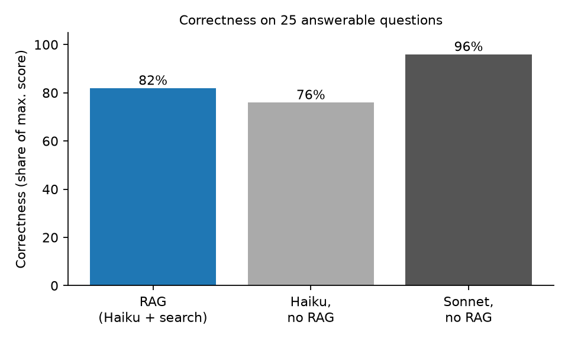

# Regulatory Copilot

RAG system for regulatory questions about medical device software. You ask a question
(German or English) and get an answer based **only** on the original legal texts (MDR, GDPR, AI Act),
with every statement backed by a source (e.g. "MDR Art. 10(9)") and the original quote.

**Live demo:** https://huggingface.co/spaces/LSAPilot/medical-app-regulatory-helper

> **Status:** MVP live on Hugging Face Spaces; validation against Haiku and Sonnet without RAG done (see [Results](#validation-results)).

## Important notices
- **Not legal advice.** This is a research/portfolio tool. Do not rely on it for compliance decisions.
- **IEC 62304 is not included.** The standard is paid and its text may not be reused freely.
  The knowledge base covers only the freely available EU texts below.
- Questions are not stored.

## How it works
```
Indexing (once)   EUR-Lex XHTML -> chunks (article paragraphs, annexes, recitals, stable IDs)
                  -> BM25 index + embeddings (bge-small-en-v1.5)

Question          follow-up? -> rewrite into a standalone English search query (uses the last 3 rounds)
                  -> hybrid search: BM25 + vector, merged by Reciprocal Rank Fusion (RRF)
                  -> similarity threshold: if the best hit is too weak, answer "not in the sources" without calling the LLM
                  -> Claude Haiku answers from the passages only and returns JSON (answer + cited chunk IDs)
                  -> ID check: every cited ID must be one of the retrieved passages, otherwise it is dropped
                  -> citations and quotes are taken from our own chunk data, never from model output
```
The last two steps mean the model cannot invent a citation: the quoted text always comes from the stored legal text.

## Design decisions
- **Source data:** official XHTML from the EU Publications Office (Cellar API); eur-lex.europa.eu itself answers automated requests
  with an empty HTTP 202. The consolidated MDR has no recitals, so they come from the original 2017 act and are marked as such.
- **Chunks:** one per article paragraph, annex point or recital (definitions: one per term), at most 2000 characters,
  with stable IDs such as `MDR-10-9` or `MDR-ANNEX-VIII-6.3`. Citation and title are indexed with the text.
- **Embedding model:** `bge-small-en-v1.5` on CPU. On 16 test queries it found every target chunk in the top 6 like `bge-base`,
  at a quarter to a third of the compute; `all-MiniLM-L6-v2` cuts input at 256 tokens and missed 3 of 16.
- **Budget protection:** per-visitor and daily limits, an answer cache and precomputed example answers, all in memory and
  configurable via environment variables (see `.env.example`). A reached limit never calls the API.
- **Privacy:** question texts and addresses are never logged or stored; logs contain only counters, tokens and cost.

## Validation results
30 questions (22 answerable, 5 without answer in the sources, 1 follow-up session), German and English.
The RAG system (Haiku + search) was compared with Haiku and Sonnet **without** RAG in the same setup and rated by a blind judge.

| Metric | RAG (Haiku) | Haiku, no RAG | Sonnet, no RAG |
|---|---|---|---|
| Correctness, 0-2 (25 answerable) | 1.64 | 1.52 | **1.92** |
| Grounding in the source text, 0-2 | **1.84** | 1.36 | 1.48 |
| Questions without answer in the sources (5) | **5 correctly refused** | 3 hallucinated | 3 hallucinated |
| Cost per question (USD) | 0.0005 | 0.0002 | 0.0066 (assumed price) |



**Takeaway, honestly:** Sonnet without RAG is more often correct (1.92 vs. 1.64), so the hypothesis "a small model with RAG beats a bigger one"
holds only in part. RAG wins on grounding, refuses correctly when the sources contain no answer (the other systems answered
confidently anyway), and costs a fraction. The two RAG errors came from search misses on "when / how much" questions, not from the model.

**Limits:** only 30 questions (one question moves a score by 3-4 points), Claude generated the questions and judged the answers,
no legal experts took part, the Sonnet price is an assumption. Full method, search metrics, cost and limits: [`eval/README.md`](eval/README.md).

## Sources and license
- **Code:** MIT, see [`LICENSE`](LICENSE).
- **Legal texts** (`data/raw/`) are **not** under MIT. They come from [EUR-Lex](https://eur-lex.europa.eu/) / the EU Publications Office (Cellar API),
  English versions. Reuse is permitted under Commission Decision 2011/833/EU with attribution.
  The consolidated MDR text is documentation only and has no legal effect; the authentic texts are
  those in the Official Journal. Text may be restructured (split into paragraphs) by this project.

| Law | CELEX |
|---|---|
| MDR, Regulation (EU) 2017/745 (consolidated 2026-01-01; recitals from the original act) | 02017R0745-20260101, 32017R0745 |
| GDPR, Regulation (EU) 2016/679 | 32016R0679 |
| AI Act, Regulation (EU) 2024/1689 | 32024R1689 |

## Setup
```bash
uv sync
uv run regulatory-helper fetch     # downloads raw files into data/raw/ (+ manifest.json with hashes)
uv run regulatory-helper ingest    # splits them into data/processed/chunks.jsonl
uv run regulatory-helper index     # embeddings + BM25 index (downloads the embedding model once, a few minutes on CPU)
uv run regulatory-helper search "Rule 11 software classification" --mode hybrid   # bm25 | vector | hybrid, --k 6
uv run regulatory-helper ask "Ist meine App ein Medizinprodukt?" --lang de [--mode hybrid] [--no-rewrite] [--verbose]
uv run regulatory-helper chat --lang de   # session with follow-up questions (last 3 rounds, kept only in memory)
uv run python app.py                      # Gradio app at http://127.0.0.1:7860 (also: regulatory-helper serve)
uv run python scripts/build_space.py --space-dir <space-clone>   # copy what the Hugging Face Space needs into its clone (or set SPACE_DIR; no git commands)
uv run pytest                             # API is mocked in tests, no cost
```
Copy `.env.example` to `.env` and set `ANTHROPIC_API_KEY` (needed for `ask`/`chat`, never commit it).

## Project structure
```
src/regulatory_helper/   fetch, chunking, retrieval (BM25 + vector + RRF), generate (rewrite, answer, ID check), service + limits, Gradio UI, CLI
app.py                   entry point for the app and the Space
scripts/                 evaluation runs, reports, Space sync (build_space.py)
data/raw/                original EUR-Lex files + manifest with hashes
data/processed/          chunks and search index (generated)
eval/                    validation: questions, answers, blind judgements, search metrics, report (eval/README.md)
tests/                   pytest suite (API mocked)
```
