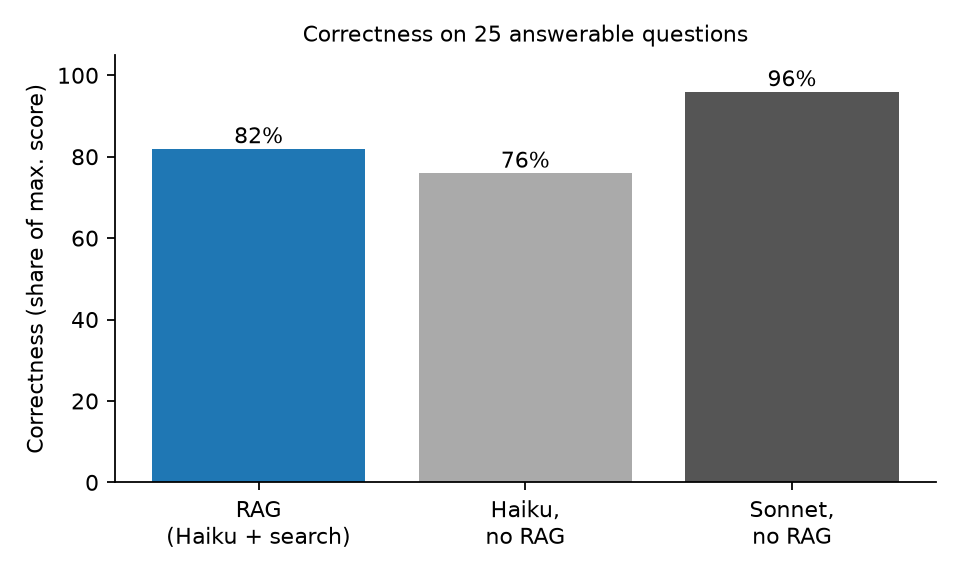
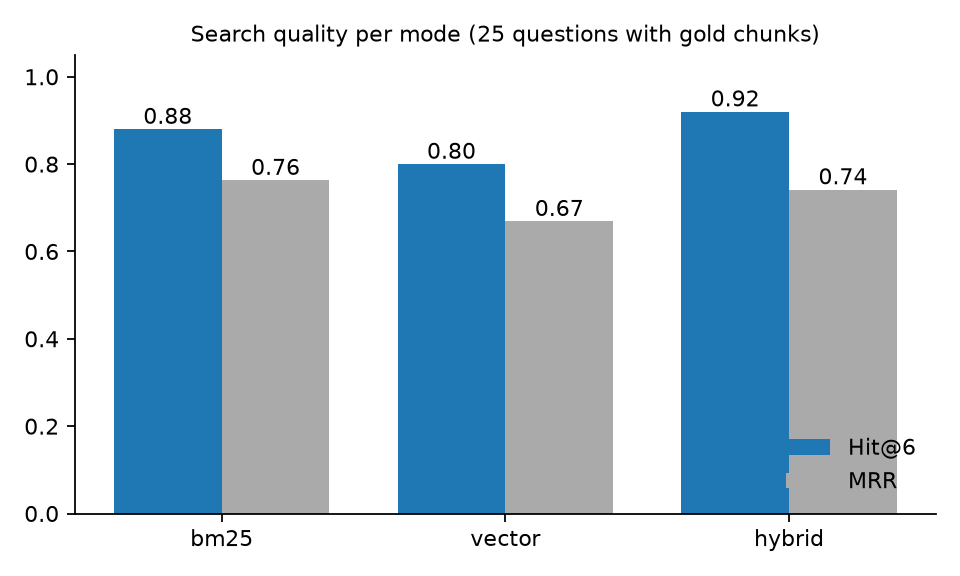

# Evaluation: does RAG help?

30 questions ([`questions.jsonl`](questions.jsonl): 22 answerable, 5 without answer in the sources, 1 follow-up session with 3 turns; German and English). Three systems answered every question in the same setup (same answer instruction, effort `low`, `max_tokens` 2000, follow-ups with the system's own earlier answers as history):

1. **RAG**: our system (`answer_question`: query rewriting, hybrid search, threshold, Haiku with JSON, ID check),
2. **Haiku without RAG** (`claude-haiku-5-5`),
3. **Sonnet without RAG** (`claude-sonnet-5-5`).

A judge (Claude subagent with fresh context, no API) rated the answers blind: answers appeared as A/B/C in random order per question, system names were hidden. Everything is reproducible from this folder (`scripts/run_eval.py`, `scripts/judge_packet.py`, `scripts/build_evaluation.py`); more charts in [`plots/`](plots/).

## Answer quality

| Metric | RAG (Haiku + search) | Haiku, no RAG | Sonnet, no RAG |
|---|---|---|---|
| Correctness, mean 0-2 (25 questions with answer) | 1.64 | 1.52 | 1.92 |
|   of which fully correct (2) | 18/25 | 15/25 | 23/25 |
| Grounding, mean 0-2 (with answer) | 1.84 | 1.36 | 1.48 |
| Citation correctness (with answer) | 22 yes / 2 partly / 0 no / 1 none | 18 yes / 7 partly / 0 no / 0 none | 22 yes / 3 partly / 0 no / 0 none |
| No-answer questions (5) | 5 refused / 0 partial+gap / 0 hallucinated | 0 refused / 2 partial+gap / 3 hallucinated | 1 refused / 1 partial+gap / 3 hallucinated |
| Follow-up resolved (3 turns) | 3/3 | 3/3 | 3/3 |
| Brevity/usefulness, mean 0-2 (all 30) | 1.60 | 1.47 | 1.47 |
| Correctness on no-answer questions, mean 0-2 | 2.00 | 0.60 | 0.80 |

Scales: correctness, grounding, usefulness 0 to 2 (judge schema). The judge saw the RAG answer text only, not its source list, so grounding is judged against the original text for all systems alike.

## Search (no LLM)

Hit@6 and MRR on the 25 questions that have gold chunks (22 answerable + 3 follow-ups). A hit means a gold chunk (or a sub-chunk `-sN` of it) is in the top 6. The query is the English rewrite that Haiku produced in the RAG run, as in production.

| Mode | Hit@6 | MRR |
|---|---|---|
| bm25 | 0.88 | 0.763 |
| vector | 0.80 | 0.669 |
| hybrid | 0.92 | 0.742 |

## Cost

| System | Model | Input tokens | Output tokens | Cost (USD) | per question |
|---|---|---|---|---|---|
| RAG (Haiku + search) | claude-haiku-5-5 | 66643 | 16784 | 0.015 | 0.0005 |
| Haiku, no RAG | claude-haiku-5-5 | 6991 | 9007 | 0.005 | 0.0002 |
| Sonnet, no RAG | claude-sonnet-5-5 | 7409 | 11719 | 0.198 | 0.0066 |
| **Total** | | | | **0.218** | |

**Caveat:** The Sonnet 5.5 price could not be looked up in the headless run. 3/15 USD per million tokens (input/output) was assumed as a conservative figure, so the real Sonnet cost may be lower. Haiku uses the prices from `Config`. Estimate before the run: `uv run python scripts/run_eval.py estimate`.

## Threshold for "nothing found" (proposal, not applied)

| Group | n | min | median | max |
|---|---|---|---|---|
| With answer | 25 | 0.770 (q29) | 0.844 | 0.906 |
| Without answer | 5 | 0.654 (q25) | 0.733 | 0.755 (q27) |

Best cosine of the hybrid top-6 for the rewritten query (as in production). Without-answer questions: q25 0.654, q23 0.726, q24 0.733, q26 0.753, q27 0.755.

| Threshold | with-answer questions wrongly blocked | no-answer questions blocked before the LLM |
|---|---|---|
| 0.60 | 0/25 | 0/5 |
| 0.70 | 0/25 | 1/5 |
| 0.75 | 0/25 | 3/5 |
| 0.76 | 0/25 | 5/5 |
| 0.78 | 1/25 | 5/5 |

**Proposal: 0.70** (current provisional value: 0.60). Not applied to `Config`, not synced to the Space.

Reasoning:
- With-answer questions have a best cosine of at least 0.77 (median 0.84); without-answer questions reach 0.65 to 0.76. The ranges touch (gap of only 0.014 between q29 at 0.770 and q27 at 0.755). A threshold of 0.76 would separate all 30 questions perfectly, but it is fitted to this set and leaves no margin: a slightly weaker real question would be blocked wrongly.
- 0.70 blocks no answerable question (margin 0.07 below the weakest one) and stops clear off-topic queries (q25 DiGA at 0.654) before the LLM call. Near-miss questions (0.73 to 0.76: IEC 62304, FDA, Cyber Resilience Act, VAT) pass the threshold and are left to the model, which refused or named the gap correctly in 5/5 cases here.
- 0.60 (current) blocked none of the five, so it only protects against nonsense; raising to 0.70 costs nothing on this set.
- The threshold is a cheap pre-filter, not the main protection against hallucination. The model's `found` decision and the ID check did that work in this run. Re-check with more near-miss questions before moving higher.

## Examples

**1. Invented details without RAG: reporting deadline (q03).** "How fast must a manufacturer report a serious incident?" Haiku without RAG gives the 15-day rule correctly but garbles the shorter deadlines (judge: wrong, correctness 0). RAG and Sonnet got the 15 and 10 days right; RAG omitted the 2-day case (correctness 1), Sonnet cited Art. 87(4)-(5) wrongly (1).

**2. Confident answers without source (q24, q25).** On IEC 62304 and the DiGA process at BfArM (not in the corpus), both no-RAG models answered confidently from general knowledge (judge: both no-RAG models hallucinated on 3 of 5 no-answer questions, q24 to q26; Sonnet's DiGA answer cites SGB V sections and prices). RAG said that nothing in the sources covers it (correctly refused, 5/5 on the five no-answer questions). Caveat: the no-RAG models are not wrong about everything there; the point is that nothing is verifiable against the supplied sources.

**3. RAG failure: honest miss (q13, q22).** For the GDPR fine question (q13) the right chunk (GDPR Art. 83(5)) was not in the top 6 (hybrid rank 10); Haiku correctly refused, but the answer is wrong for the user (correctness 0), while both no-RAG models answered correctly. For the AI Act application dates (q22) the right chunk (Art. 113) ranked 42nd in hybrid, so RAG gave a partial, misleading answer (correctness 0). Weak spots are retrieval on "when/how much" questions, not the language model.

**4. Rewrite artefact (q06).** The rewritten query contained "Translation: ..." and a long explanation (the rewrite prompt asks for one keyword line). The search still succeeded, but this pollutes BM25 and is a candidate for a prompt fix.

## Limits of the study
- Small set (30 questions, only 5 without answer, one follow-up session of 3 turns). Results are tendencies, not statistically sound differences; one question changes a percentage by 3 to 4 points.
- Claude generates the questions and judges Claude's answers. Mitigated by a separate reviewer, binding to the original text and blind judging, but not ruled out (a judge may favour its own style or share blind spots with the generator).
- No human experts with legal training rated anything.
- The judge's grounding score for the no-RAG systems is relative to the supplied source text, not to the full law. The Sonnet price is an assumption (see Cost).
- The threshold was calibrated on the same 30 questions it is evaluated on (see above).
